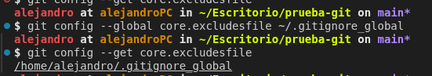
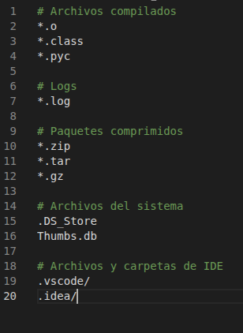
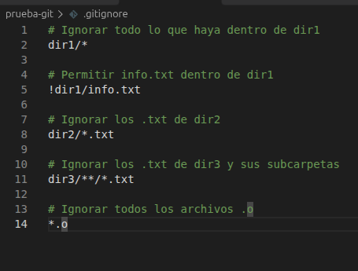
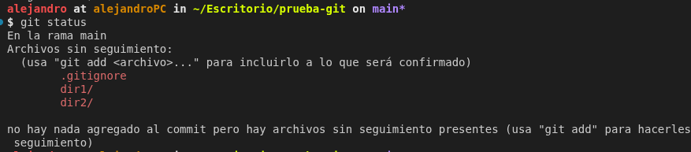
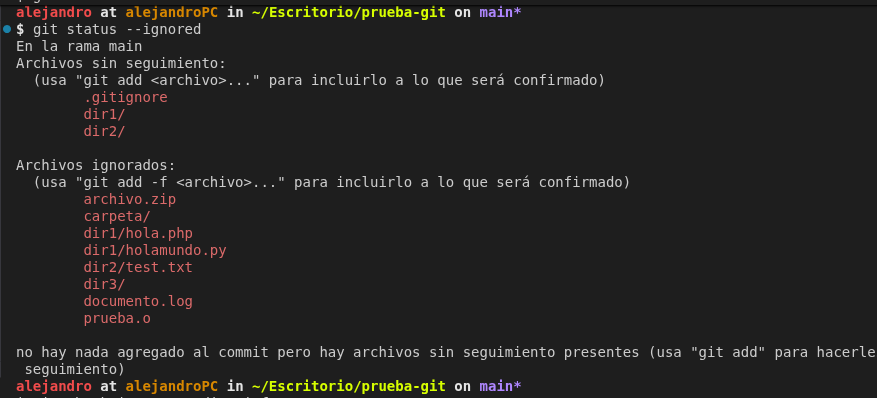

# Experimento con `.gitignore`

## 1. Objetivo

Comprobar el funcionamiento de `.gitignore_global` y `.gitignore`, utilizando diferentes patrones para ignorar archivos y carpetas.

## 2. `.gitignore_global`

Primero comprobé la configuración con:

```bash
git config --get core.excludesfile
```

Como no estaba configurado, creé el archivo:

```text
/home/alejandro/.gitignore_global
```

Y lo configuré con:

```bash
git config --global core.excludesfile ~/.gitignore_global
```




El archivo contiene:

```gitignore
*.o
*.log
*.zip
.DS_Store
.vscode/
.idea/
```



Estos patrones sirven para ignorar archivos comunes como archivos compilados, logs, archivos comprimidos y archivos de configuración del sistema o del IDE.

## 3. `.gitignore` local

En el repositorio creé un `.gitignore` con:

```gitignore
dir1/*
!dir1/info.txt
dir2/*.txt
dir3/**/*.txt
*.o
```




## 4. Comprobación

Ejecuté:

```bash
git status
```




Después ejecuté:

```bash
git status --ignored
```



Los archivos que cumplen las reglas aparecen como ignorados


También comprobé `info.txt` con:

```bash
git check-ignore -v dir1/info.txt
```

La regla `!dir1/info.txt` permite que este archivo no sea ignorado.

## 5. Diferencia entre los dos archivos

`.gitignore_global` contiene reglas generales que se aplican a los repositorios del usuario.

`.gitignore` contiene reglas específicas del repositorio en el que se encuentra.

## 6. Recursos

* [Documentación oficial de GitHub sobre `.gitignore`](https://docs.github.com/es/get-started/git-basics/ignoring-files)
* [Documentación oficial de GitHub sobre Markdown](https://docs.github.com/es/get-started/writing-on-github)
